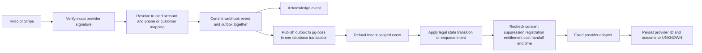

# LeadRescue architecture

This repository implements a modular Next.js application and a separate persistent Node.js worker. PostgreSQL is the durable source of truth. Supabase Auth supplies identity; Supabase's user-context database client enforces RLS for ordinary requests. Privileged adapters and worker modules are server-only. The public demo uses synthetic, explicitly labeled data; it does not authenticate a real account or simulate successful SMS, billing or calendar operations in production.

## Processes and provider boundaries

| Component         | Implementation                                          | Responsibility                                                                                                    |
| ----------------- | ------------------------------------------------------- | ----------------------------------------------------------------------------------------------------------------- |
| Web application   | Next.js App Router, TypeScript, React                   | Public pages, auth, onboarding, dashboard, validated APIs, signed webhook admission                               |
| Identity/database | Supabase Auth/PostgreSQL                                | Password/session lifecycle, memberships, tenant RLS, durable state and atomic RPCs                                |
| Telephony         | Twilio SDK adapter                                      | Verified call forwarding, number acquisition, signed events, two-way SMS and status callbacks                     |
| Worker            | Node.js + pg-boss                                       | Publish transactional outbox, process tenant-ordered events, eligibility gates, AI, reconciliation, reminders     |
| Qualification     | OpenAI Responses adapter                                | Bounded, schema-validated fact extraction without tools; deterministic response templates                         |
| Billing           | Stripe adapter                                          | Hosted checkout/portal, signature verification, provider-state reconciliation; merchant approval remains external |
| Calendar          | Google Calendar OAuth adapter                           | Encrypted refresh tokens, free/busy, customer-confirmed inspection requests and deterministic event IDs           |
| Notifications     | Database notifications with optional configured adapter | Owner-visible callbacks, billing/AI/booking review and trial reminders                                            |

No live AI calling, AI voice receptionist, CRM synchronization, arbitrary URL fetching, general file uploads or raw card processing is implemented. Approved FAQs, services, restrictions, service ZIPs, timezone, hours and escalation contact are configuration data. Security-sensitive restrictions are enforced by code; arbitrary restriction text is not executable policy.

The Next.js server requires a Node-compatible host. The separate worker requires a continuously running process and PostgreSQL connectivity. Cloudflare Sites Workers alone do not provide this worker model/raw PostgreSQL connection contract; do not advertise the full system as deployable there without a compatible external worker and transport redesign. A static demo deployment is separate from the live service architecture.

## Queue decision

pg-boss is selected over Redis-backed BullMQ. Both provide durable storage/retries with properly operated backends. pg-boss uses the PostgreSQL database already required by the app, avoiding a separate Redis service and its persistence configuration/cost. The installed version supports `key_strict_fifo`; each job has a server-derived business singleton key so a business's model/event/send jobs run in order across worker processes. This conservatively serializes all conversations of one business. It prioritizes correctness over maximum per-business throughput and requires representative measurement before capacity claims.

An outbox row and its business operation/event commit in the same transaction. Publication inserts the pg-boss job using the same PostgreSQL transaction as the outbox's published marker. No network provider side effect occurs inside that transaction. Queue jobs carry IDs, then reload the authoritative tenant-scoped outbox record; AI and browser payloads cannot select another tenant. Retries are bounded and a dead-letter queue retains failures. A failed strict FIFO key may block later work for that tenant until operator intervention; monitoring and a safe dead-letter replay procedure are launch requirements. PostgreSQL storage/retention, queue schema migrations and host sizing remain operational costs. No Redis Pub/Sub queue is used.

## Event flow

Voice webhooks return valid TwiML after bounded authentication, mapping and durable capture; they do not wait for AI. The `<Dial>` forwarded leg supplies the recovery outcome. Parent call and forwarded child are separate records. Completed forwarding can mean voicemail and is not treated as proof that a human answered. Contradictory terminal callbacks create a review notification rather than another recovery sequence. Signed callback composites distinguish event type/status/sequence; a CallSid alone is not the event identity.

STOP/provider opt-out handling updates suppression and revokes local consent during admission before acknowledgement. Ordinary inbound processing can then follow asynchronously. A call alone does not create SMS permission. Unsupported callers or missing eligibility evidence require a manual callback. Before every send, the worker rechecks current suppression/consent, sender registration, operator-verified contact geography/line eligibility, quiet hours, stale age, cooldown, takeover, entitlement and hard quota. A dispatch lease serializes the send boundary against takeover. A provider may already be accepting a network request when a new STOP arrives; provider suppression is an additional boundary and this implementation does not promise to retract an accepted message.

## State machines

Business states are `account_created`, `phone_pending`, `messaging_pending`, `ready_for_test`, `trial_active`, `paid_active`, `automation_paused`, and `canceled`. Provider routing readiness, messaging registration, subscription status, trial timestamps, administrative holds, and suppression remain separate records. UI navigation or checkout return URLs never grant entitlements.

Trial activation requires confirmed account membership, operator-verified business and destination, approved messaging registration, a successful real test and an unused verified destination identity hash. It starts exactly 14 days from activation. Duplicate identity checks are proportionate signals rather than proof of legal-business identity; operator verification and abuse review are necessary. Trial and paid allowances live in entitlements, with atomic reservations. The initial database price is 29,900 USD minor units and hard-cap overage behavior is `pause`; an operator must ensure the configured Stripe price and displayed allowance match the approved business terms before enabling checkout. No automatic overage charge is implemented.

Subscription state comes from verified provider fetches and local reconciliation, not webhook metadata alone. A zero-value trial invoice does not establish a paid period. Operator and payment-risk holds persist separately from ordinary payment state so renewal cannot silently remove a safety hold. Retain call routing, suppression and essential account access when automation pauses.

Messages distinguish `pending`, `submitted`, `sent`, `delivered`, `undelivered`, `failed`, `unknown`, `received`, and `suppressed`. Send intent is persisted before dispatch. Timeouts or local persistence failures after potential provider acceptance become unknown and retain budget; workers do not blindly resend. Delivery callbacks cannot regress a terminal result. An operator must reconcile unknown provider IDs/outcomes before creating another attempt.

Phone acquisition also records an intent before a provider purchase. Only one phone per business is permitted. Pending or unknown acquisitions block another purchase. Exact proven provider results can finalize idempotently; orphaned/unknown numbers require operator inventory reconciliation before retry or release. Routing stays disabled and registration pending after purchase until separate verification prerequisites complete.

Inspection appointments progress from `requested` to customer-confirmed `pending`, then `confirmed` only after provider creation and local persistence. Signed, expiring confirmation tokens bind the business and appointment; confirmation is a POST and is single-use in database state. Missing calendar produces an honest callback request. Fixed 60-minute inspections use 15-minute buffers and IANA timezone hours, including explicitly disabled days. Application overlap protection covers pending, confirmed and unknown outcomes. Google can change independently, so free/busy checks and deterministic ID reconciliation reduce but cannot eliminate external concurrency conflicts.

## Tenant and admin boundary

Tenant-owned rows use non-null business IDs and tenant-consistent composite relationships. User requests use provider-verified identity and database membership roles. RLS also checks the signed session ID against `auth.sessions`, blocking explicitly revoked sessions even before their JWT would expire. Service-role calls bypass RLS and must explicitly scope tenant operations. Global maintenance queries are restricted internal operations, never user-facing query capabilities.

Platform admins are bootstrapped into a private registry by restricted SQL procedure and require verified `aal2`; contractor owners receive no platform authority. Support operations require a reason and write a tenant audit event. No default impersonation, public admin signup, first-user promotion or hardcoded password exists.

## Reliability limits and launch evidence

The database suite executes actual PostgreSQL policy/constraint/RPC behavior in PGlite using synthetic Auth schema stubs. Hosted Supabase Auth/JWT transport, PostgreSQL multi-process contention, pg-boss restarts, Twilio registration/delivery, real OpenAI evaluation/cost, Stripe merchant approval/payment acceptance, Google OAuth consent/booking and managed backup restoration remain separate acceptance gates. Embedded/mock results do not prove external provider throughput, compliance, security certification, or support for any advertised number of customers.

References: [pg-boss](https://github.com/timgit/pg-boss), [BullMQ queues](https://docs.bullmq.io/guide/queues/), [Next.js authorization](https://nextjs.org/docs/app/guides/authentication), [Supabase sessions](https://supabase.com/docs/guides/auth/sessions), [Twilio webhook security](https://www.twilio.com/docs/usage/webhooks/webhooks-security), [Stripe subscription webhooks](https://docs.stripe.com/billing/subscriptions/webhooks).
