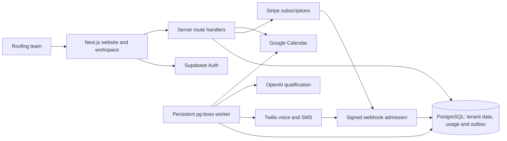

<div align="center">


# 📞 LeadRescue AI

### Recover missed enquiries. Qualify leads. Keep your team in control.

<p>
A full-stack missed-call recovery platform for U.S. roofing teams, combining
eligible SMS follow-up, AI qualification, a shared inbox, inspection requests
and subscription management.
</p>

<p>
  
  
  
  
</p>

<p>
  
  
  
  
</p>

<p>
  <a href="https://github.com/KushagraSrivastava3028/LeadRescue-AI/actions/workflows/ci.yml"></a>
  
  
</p>

[Quick start](#quick-start) · [Features](#features) · [Architecture](#architecture) · [Deployment](#deployment-web-and-worker) · [Remaining work](REMAINING_WORK.md)

</div>

---

## Overview

**LeadRescue AI** helps roofing teams keep eligible missed-call enquiries moving.
The workspace brings conversations, customer details, lead status, callback tasks
and inspection requests together, with explicit human takeover when needed.

> **Project status:** Local implementation is verified; live services are not
> activated and the app is not deployed. No real messages, charges, calls, emails
> or calendar bookings were performed. Integration code exists; accounts,
> credentials, approvals and hosted acceptance tests remain necessary. See
> [remaining work](REMAINING_WORK.md) and the [launch checklist](LAUNCH_CHECKLIST.md).
> Terms and Privacy are drafts.

### Recovery workflow

```text
Missed call and verified outcome
                ↓
Check consent, suppression, eligibility and usage limits
                ↓
Eligible SMS follow-up and AI qualification
                ↓
Team inbox → human takeover or callback task
                ↓
Inspection request → customer confirmation → calendar booking
                ↓
Owner tracks the result
```

A missed call alone never grants consent to send an SMS. Uncertain provider
outcomes are retained for reconciliation instead of blindly retried.

## Features

| Area                  | Implemented capabilities                                                                         |
| --------------------- | ------------------------------------------------------------------------------------------------ |
| Responsive workspace  | Overview metrics, recent enquiries, filters and mobile navigation                                |
| Shared inbox          | Conversation history, manual takeover/resume, reply intents and callback tasks                   |
| Lead management       | Enquiry creation, status updates, owner-confirmed won jobs and private exports                   |
| Accounts and teams    | Signup, verification, recovery, MFA, invitations and owner/staff/viewer permissions              |
| Business settings     | Services, ZIP codes, timezone, weekday hours, FAQs and assistant restrictions                    |
| Eligible recovery     | Signed call/SMS callbacks, consent/suppression gates, quiet hours and cooldowns                  |
| AI qualification      | Bounded extraction, validated output, controlled reply templates and spending ceilings           |
| Inspection scheduling | Customer confirmation, availability checks, duration/buffer rules and Google OAuth               |
| Subscriptions         | Stripe checkout/portal adapters, trial prerequisites, usage caps and subscription reconciliation |
| Operations            | Durable PostgreSQL jobs/outbox, retries, deduplication, health checks and audited admin holds    |

The demo uses synthetic browser-local data. Real integration behavior requires
provider configuration and staging verification.

## Architecture



The web service and worker run as separate Node processes. Normal workspace
access uses Supabase Auth and RLS. Privileged worker SQL is explicitly tenant
scoped. Provider secrets remain server-side; no Redis service is required.

## Technology stack

| Layer                | Technologies                                                                      |
| -------------------- | --------------------------------------------------------------------------------- |
| Application          | Next.js 16, React 19, TypeScript, CSS and Lucide icons                            |
| Backend/auth         | Next.js Route Handlers, Supabase Auth and PostgreSQL RLS                          |
| Jobs and database    | pg-boss, node-postgres, versioned SQL migrations                                  |
| Integrations         | Twilio, OpenAI, Stripe and Google Calendar                                        |
| Validation/security  | Zod, signed cookies, provider signature verification and AES-GCM token encryption |
| Quality              | Vitest, PGlite, Playwright, k6, ESLint, Gitleaks and GitHub Actions               |
| Deployment packaging | Separate Node web/worker processes; Docker targets and Compose configuration      |

## Project structure

```text
LeadRescue-AI/
├── src/app/                 # Public/account pages, workspace and API handlers
├── src/components/          # Marketing, workspace and account components
├── src/lib/server/          # Authorization, security and provider adapters
├── src/worker/              # Durable recovery, billing and booking handlers
├── supabase/migrations/     # Versioned schema, RLS and measured indexes
├── supabase/rollback/       # Reviewed performance-index rollback
├── tests/                   # Unit, SQL integration and browser regressions
├── load-tests/              # Guarded local/staging k6 journeys
├── scripts/                 # Migration, runtime, benchmark and scanning tools
├── docs/                    # Integration, security and scaling procedures
├── .github/                 # CI and dependency-update configuration
├── REMAINING_WORK.md        # Ordered setup and release checklist
└── LAUNCH_CHECKLIST.md      # Detailed external acceptance gates
```

## Quick start

```sh
git clone https://github.com/KushagraSrivastava3028/LeadRescue-AI.git
cd LeadRescue-AI
npm ci
npm run dev
```

## Run the demo

Use Node 24 LTS (the development checks here used Node 26.8.1), npm, and the committed lockfile:

```sh
npm ci
npm run dev
```

Open **http://127.0.0.1:3000** for the product site, or **http://127.0.0.1:3000/demo** for the workspace. No environment file is required to explore the demo. It includes working lead filters, conversation selection, human takeover/resume, local replies, lead creation/status updates, callback tasks, inspection requests, calendar agenda, settings, exports, and billing previews. All demo changes stay in browser storage; the Help dialog can reset them. Demo actions never send provider requests. The real `/app` route always requires verified Supabase identity and membership.

Public routes: `/`, `/pricing`, `/signin`, `/signup`, `/verify-email`, `/forgot-password`, `/reset-password`, `/two-factor`, `/privacy`, `/terms`. Workspace routes under `/demo` or `/app`: overview, `/inbox`, `/leads`, `/calendar`, `/assistant`, `/settings`, `/billing`. `/admin` and its API require separately bootstrapped platform authority and verified MFA. `/invite` and `/confirm-inspection` use short-lived recipient links with tokens in URL fragments, then explicit POST actions.

## Connect a development workspace

1. Copy `.env.example` to ignored `.env.local` using your editor. Enter real credentials **only** locally or in your hosting secret manager. Never paste them into chat or commit them. Set `APP_ORIGIN` exactly to `http://127.0.0.1:3000` for local development. Do not mix localhost and 127.0.0.1 origins.
2. Create a separate development Supabase project, enable email confirmation, configure SMTP, and set its URL, publishable key, service-role key, and a securely generated 32+ character `AUTH_COOKIE_SECRET`. Supabase stores passwords; the app has no custom credential database.
3. Apply `supabase/migrations/*.sql` in order with `npm run db:migrate` through an authorized direct/session operator connection (`MIGRATION_DATABASE_URL`, falling back to `DATABASE_URL`). Ordinary migrations remain atomic with their checksum ledger. Migration `0007` creates indexes concurrently, one explicitly marked statement at a time outside a transaction; its ledger entry is written only after all indexes are valid. Do not pass the whole `0007` file to a tool that wraps it in a transaction. Local Supabase CLI/Docker bootstrap and hosted migrations remain unverified here; verify the CLI's nontransactional migration behavior before using reset/push workflows with this file. See [the apply/rollback instructions](docs/DATABASE_PERFORMANCE.md).
4. Set Supabase Site URL and exact redirect allowlists to your configured origin and `/auth/callback`. For password recovery, use a provider email template linking to `{{ .SiteURL }}/auth/confirm?token_hash={{ .TokenHash }}&type=recovery`. This verified recovery path issues the short-lived HttpOnly reset grant. Do not substitute an arbitrary return URL. Confirmation token query parameters are inherent in the provider email protocol; redact them from reverse-proxy logs.
5. Run `npm run check:env`. Create and verify an account, then create its business with service ZIP codes and timezone. Settings supports business facts, weekday hours, FAQs, restrictions, team invitations, MFA enrollment, phone setup, and Google Calendar connection. Owners alone manage sensitive settings; staff handle enquiries; viewers read. An owner must confirm a won job.
6. Set a restricted worker `DATABASE_URL`, then run `npm run worker` in a separate terminal. Worker `/health` on port 3001 is internal. Do not expose this port publicly. See [docs/INTEGRATIONS.md](docs/INTEGRATIONS.md) for exact provider variables, callbacks, queue behavior, and reconciliation.

Optional integrations are disabled until their explicit enable flag and required variables are set. Enabled integrations never fall back to synthetic success. A missing credential returns a safe unavailable result. Production startup rejects missing/placeholder auth configuration, HTTP/loopback origins, and `DEMO_MODE=true`.

## Provider activation

- **Twilio:** assign a dedicated approved subaccount and encrypted token through the restricted operator procedure, approve a verified U.S. forwarding destination, configure signed voice/Dial-action/SMS/status URLs, complete messaging registration, and validate geography/line type. Settings can request a number and place an authorized destination-verification call; neither action grants routing or registration approval. Uncertain purchases block retry until reconciled.
- **Consent:** a missed call is never consent. Operators must validate the approved disclosure/evidence, sender/scope, country and SMS capability before automation can send. STOP revokes/suppresses queued work. Missing consent creates a callback opportunity. The consent API stores an evidence-review request, not an unverified permission grant.
- **AI:** enable a selected pinned OpenAI snapshot and reviewed per-call/platform cost limits. It extracts facts only; it has no tools, booking authority, or tenant selector. Replies use bounded application templates. Real model evaluation and account retention review are launch gates.
- **Billing:** the initial configurable plan is $299 USD/month, 500 outbound segments and 500 AI replies; the trial is 14 days with 100-segment/AI allowances. Verify the provider price matches reviewed product terms. Merchant approval is required, including actual India-entity availability where applicable. Checkout requires explicit recurring terms; only verified provider state enables paid usage. Overage charging is off. Trial activation requires business/phone verification, messaging approval, and a successful real test; the browser cannot set these flags.
- **Calendar:** Google OAuth uses exact callback/state/PKCE and two narrow scopes, with tenant-bound AES-GCM refresh-token encryption. The team requests a slot, then shares a private link for the customer's explicit confirmation. A booking remains requested/pending until provider creation and local persistence succeed. Unknown outcomes retain the slot for reconciliation. Current inspections are 60 minutes with a 15-minute buffer.

The operator steps, APIs, SQL boundaries, and external acceptance procedure are detailed in [docs/DATABASE.md](docs/DATABASE.md), [docs/INTEGRATIONS.md](docs/INTEGRATIONS.md), and [LAUNCH_CHECKLIST.md](LAUNCH_CHECKLIST.md). There is no browser switch that declares a business verified or a messaging policy approved.

## Deployment: web and worker

Run on a Node/container host with PostgreSQL connectivity and persistent worker processes. The full application is **not** published to Sites/Cloudflare Workers: its Node pg-boss worker and PostgreSQL transport require a compatible host. No live customer system was modified. Docker targets and Compose are provided, but a Docker build/deployment was not executed here.

```sh
npm ci
npm run check:env -- --production --worker
npm run build
npm start
# Separate process/deployment:
npm run worker
```

Or use `docker compose up --build -d` after securely creating `.env.local`. Compose binds web only to loopback; put a configured HTTPS reverse proxy in front. Deploy the `web` and `worker` Docker targets as separate services. Both run without root; runtime production variables come from the secret manager, not build arguments. Keep staging/prod databases, provider subaccounts, callback URLs, and secrets separate.

Use a migration-only identity for DDL/backups and distinct restricted runtime identities. Normal web reads/writes use the authenticated Supabase client and RLS. Direct provider/worker SQL is privileged and explicitly tenant-scoped. Before deployment, provision and review the worker's table/function/schema grants (including private queue/cost records and its pg-boss schema), RLS bypass, certificate-verified TLS, and the supported direct/session pooler. Do not use the database superuser as runtime identity or assume `GRANT service_role` alone inherits BYPASSRLS. The exact restricted-role/bootstrap and pooler setup must be tested against the chosen Supabase project.

`/api/health` reports web liveness without secrets; worker `/health` reports recent database/outbox ticks. Monitor webhook errors, queue age, failed FIFO heads, unknown sends/purchases/bookings, usage, registration/suppression drift, billing reconciliation, and operator response. Roll back application images to a verified prior source version; database rollback requires a reviewed forward repair or isolated provider restore. Never automatically reverse destructive migrations. See [SECURITY.md](SECURITY.md) for incident handling and [docs/DATABASE.md](docs/DATABASE.md) for the unexecuted restore drill.

## Verification

```sh
npm run typecheck
npm run lint
npm test
npm run build
npm run test:e2e  # start the local web server first; uses synthetic data only
npm audit --audit-level=high
npm run check:secrets
```

Playwright requires its matching Chromium: `npx playwright install chromium`. Gitleaks must be installed from its official checksum-verified release; the PowerShell wrapper also recognizes `.cache/gitleaks/gitleaks.exe`. Source, production browser/server artifacts, and all available Git refs are scanned with full redaction. Narrow documented allowlists cover known private Next-generated keys and an exact synthetic fixture; production browser bundles remain eligible. Never upload scanner reports or env files as CI artifacts. Enable the supplied pre-commit hook with `git config core.hooksPath .githooks` after installing Gitleaks. CI has read-only repository permissions and does not deploy or access production secrets.

The SQL suite runs real PostgreSQL in PGlite with synthetic Supabase Auth interfaces; it does not verify hosted JWT/GoTrue, multiple TCP connections, real providers, or managed backups. Browser tests verify desktop/mobile demo behavior, inert untrusted text, actual local response headers, CSRF failures, protected pages, and private-file HTTP exposure. [SECURITY_AUDIT.md](SECURITY_AUDIT.md) records exact final results, failed attempts and limitations. Complete the staging/live acceptance checklist before inviting real customers.

Current dependency review: the runtime-only audit reports no known vulnerabilities. The full graph reports 16 moderate findings in development lint dependencies; no force downgrade or incompatible override was applied. See SECURITY_AUDIT.md for the advisory and remediation limits.

## Database and scaling checks

[SCALING_REPORT.md](SCALING_REPORT.md) records the current performance work, measured limits, before/after tests, and exact browser checks. [Database measurements](docs/DATABASE_PERFORMANCE.md) map each important read to its plan/timing and the four reviewed indexes. [Caching](docs/CACHING.md) documents request-local identity reuse without sharing private data. [Host and connection budgets](docs/HOST_SCALING.md) distinguishes the undeployed current state from possible Render/Supabase plans and costs.

```sh
npm run db:benchmark   # synthetic PostgreSQL only; no credentials or live data
npm run test:load -- --profile full --base-url http://127.0.0.1:3100 --label local-full
```

The load command requires an explicitly guarded isolated local/staging server; it refuses production targets. Read [load-test setup](docs/LOAD_TESTING.md) before running it. Keep `LOAD_TESTING_ENABLED=false` for an ordinary deployed application. No new service or infrastructure purchase is required by these changes.

The recorded local suite passed **160 regression tests** and **11 browser tests**.
The compiled public/demo k6 workload completed **28,025 requests**, zero failures
and an overall p95 of **40.42 ms**, reaching 100 virtual users. These historical
local results do not certify authenticated hosted capacity or provider throughput.

## Security and access

Backend permissions are enforced independently of UI controls.

| Action                                          | Viewer | Staff | Owner |
| ----------------------------------------------- | :----: | :---: | :---: |
| Read own workspace and enquiries                |  Yes   |  Yes  |  Yes  |
| Handle leads, callbacks and conversations       |   —    |  Yes  |  Yes  |
| Request an inspection                           |   —    |  Yes  |  Yes  |
| Confirm a won job                               |   —    |   —   |  Yes  |
| Manage business settings, team and integrations |   —    |   —   |  Yes  |
| Manage billing and private exports              |   —    |   —   |  Yes  |

Platform operators require separate restricted bootstrap and verified MFA;
business ownership does not grant platform administration. Controls include
tenant RLS, session checks, origin validation, strict schemas, rate limits,
per-request CSP nonces, signed webhooks and encrypted provider tokens.
Hosted enforcement and independent security review remain release gates.

## Remaining work

- Provision Supabase and SMTP; verify real accounts, tenant permissions and MFA.
- Deploy the web and worker, connect a domain and verify HTTPS and host limits.
- Configure and accept Twilio, OpenAI, Stripe and Google Calendar individually.
- Complete authenticated staging load, native database concurrency and recovery tests.
- Finalize monitoring, backups/restoration, retention and reviewed legal documents.
- Resolve or document dependency findings and complete independent security review.

Use **[REMAINING_WORK.md](REMAINING_WORK.md)** for the ordered checklist.

## Documentation

| Guide                                           | Contents                                              |
| ----------------------------------------------- | ----------------------------------------------------- |
| [Launch checklist](LAUNCH_CHECKLIST.md)         | Provider and production acceptance gates              |
| [Database](docs/DATABASE.md)                    | Schema, permissions, migration and restore procedures |
| [Integrations](docs/INTEGRATIONS.md)            | Queue, Twilio, AI, Stripe and Google Calendar         |
| [Security model](SECURITY.md)                   | Threats, permissions, secrets and incident response   |
| [Security controls](SECURITY_CONTROL_MATRIX.md) | Local evidence and remaining verification             |
| [Security audit](SECURITY_AUDIT.md)             | Historical checks, findings and limitations           |
| [Scaling report](SCALING_REPORT.md)             | Measured changes, load results and rollback           |
| [Load testing](docs/LOAD_TESTING.md)            | Safe installation, test targets and commands          |

## Contributing

Create a focused branch, review the security and launch boundaries, and run the
checks relevant to your change. Include validation and any remaining limitations
in your pull request. Never commit credentials or real customer records.

## Maintainer

Maintained by [Kushagra Srivastava](https://github.com/KushagraSrivastava3028).
No license grant is declared in this repository; confirm licensing with the
maintainer before redistribution.

---

<div align="center">

### Your missed calls. Recovered with your team in control.

Built with Next.js, Supabase, PostgreSQL and a durable Node worker.


</div>
